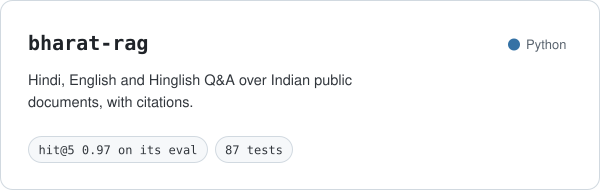
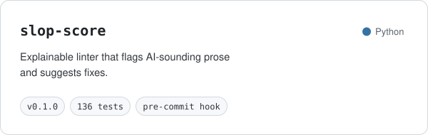

<picture>
  <source media="(prefers-color-scheme: dark)" srcset="assets/header-dark.svg">
  
</picture>

<p align="center">
  <a href="https://urnextdoor.com">urnextdoor.com</a> ·
  <a href="https://www.linkedin.com/in/mayank-urnextdoor">LinkedIn</a> ·
  <a href="https://x.com/MayankQnAPe">X</a>
</p>

I build the plumbing that makes LLMs useful in production: servers that give agents tools safely, retrieval that works for Indian users in Hindi, English and the Hinglish in between, and checks that keep AI output honest. By day I'm building [Ur Next Door](https://urnextdoor.com), a community platform for Indian neighbourhoods, cities and interest groups.

## Open source

<p>
  <a href="https://github.com/mayank-urnextdoor/mcp-kit"><picture><source media="(prefers-color-scheme: dark)" srcset="assets/card-mcp-kit-dark.svg"></picture></a>
  <a href="https://github.com/mayank-urnextdoor/bharat-rag"><picture><source media="(prefers-color-scheme: dark)" srcset="assets/card-bharat-rag-dark.svg"></picture></a>
</p>
<p>
  <a href="https://github.com/mayank-urnextdoor/ai-pr-reviewer"><picture><source media="(prefers-color-scheme: dark)" srcset="assets/card-ai-pr-reviewer-dark.svg"></picture></a>
  <a href="https://github.com/mayank-urnextdoor/slop-score"><picture><source media="(prefers-color-scheme: dark)" srcset="assets/card-slop-score-dark.svg"></picture></a>
</p>

## See it run

A Hinglish question finds the right scheme in both English and Hindi documents:


A launch post full of stock phrases scores 96 out of 100, with every hit explained:


## How I build

- **Numbers come from runs.** Every figure on this page (test counts, eval scores, demo output) is copied from a real run, not estimated.
- **Secure by default.** Hashed tokens with scopes, least-privilege CI permissions, untrusted input treated as untrusted.
- **India is not an edge case.** Devanagari, Hinglish and Windows terminals get tested, not assumed.
- **Small enough to read.** mcp-kit's core is under 1,000 lines. If you can't read it in one sitting, it's too big.

## Stack

<p>
  
</p>

Plus the Claude API, Model Context Protocol, and hybrid BM25 + dense retrieval.

## Try one in a minute

```bash
pip install git+https://github.com/mayank-urnextdoor/slop-score@v0.1.0
slop-score README.md
```
