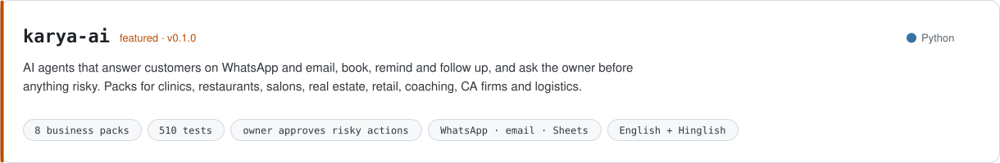
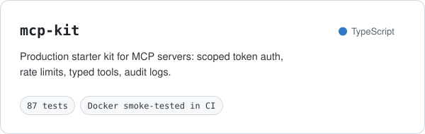
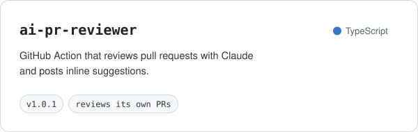

<picture>
  <source media="(prefers-color-scheme: dark)" srcset="assets/header-dark.svg">
  
</picture>

<p align="center">
  <a href="https://urnextdoor.com">urnextdoor.com</a> ·
  <a href="https://www.linkedin.com/in/mayank-urnextdoor">LinkedIn</a> ·
  <a href="https://x.com/MayankQnAPe">X</a>
</p>

I build the plumbing that makes LLMs useful in production. That means servers that hand agents tools without handing them the keys, and retrieval that understands how India actually types, Hinglish included. By day I'm building [Ur Next Door](https://urnextdoor.com), a community platform for Indian neighbourhoods and interest groups.

## Open source

<a href="https://github.com/mayank-urnextdoor/karya-ai"><picture><source media="(prefers-color-scheme: dark)" srcset="assets/card-karya-ai-dark.svg"></picture></a>

<p>
  <a href="https://github.com/mayank-urnextdoor/mcp-kit"><picture><source media="(prefers-color-scheme: dark)" srcset="assets/card-mcp-kit-dark.svg"></picture></a>
  <a href="https://github.com/mayank-urnextdoor/bharat-rag"><picture><source media="(prefers-color-scheme: dark)" srcset="assets/card-bharat-rag-dark.svg"></picture></a>
</p>
<p>
  <a href="https://github.com/mayank-urnextdoor/ai-pr-reviewer"><picture><source media="(prefers-color-scheme: dark)" srcset="assets/card-ai-pr-reviewer-dark.svg"></picture></a>
  <a href="https://github.com/mayank-urnextdoor/slop-score"><picture><source media="(prefers-color-scheme: dark)" srcset="assets/card-slop-score-dark.svg"></picture></a>
</p>

## See it run

A Hinglish question finds the right scheme in both English and Hindi documents:



A launch post full of stock phrases scores 96 out of 100, with every hit explained:



## How I build

Every number on this page comes from a real run: the test counts, the eval score, the terminal output above. Nothing is estimated.

Security is the default, not a feature. Tokens are stored hashed and carry scopes; CI jobs get the least permission they need.

India is not an edge case. Devanagari text and Hinglish queries get tested on Windows terminals too, because that's where a lot of Indian developers work.

Small beats clever. mcp-kit's core is under 1,000 lines, and you can read it in one sitting.

## Stack

<p>
  
</p>

Plus the Claude API and Model Context Protocol on the AI side.

## Try one in a minute

```bash
pip install git+https://github.com/mayank-urnextdoor/slop-score@v0.1.0
slop-score README.md
```
